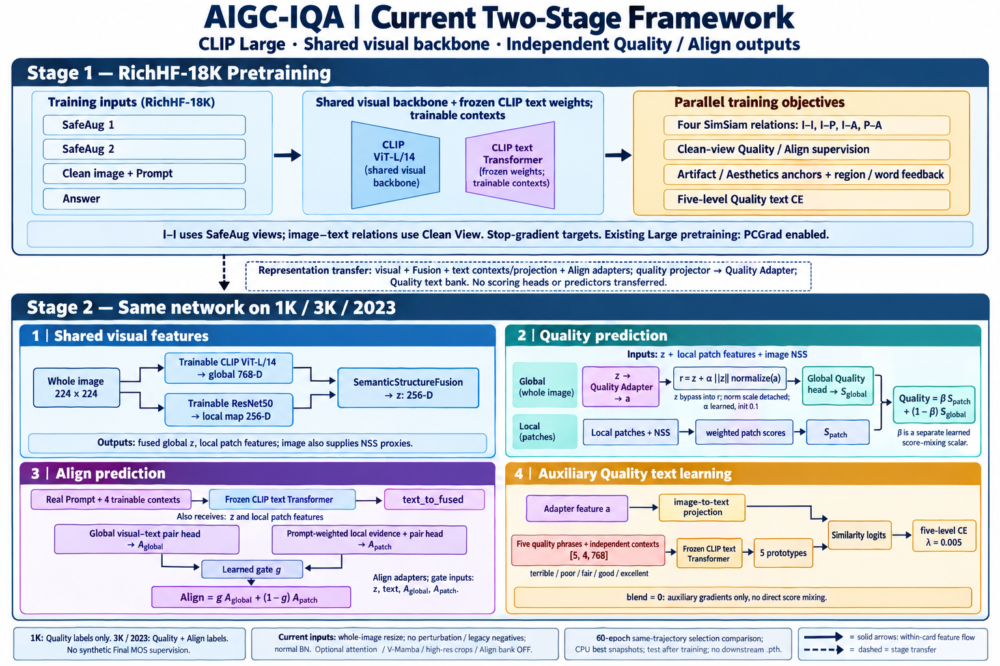
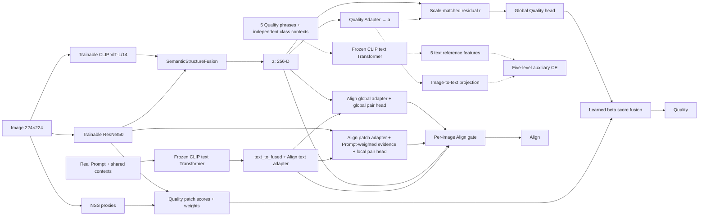

# 当前 AIGC-IQA 项目框架



图由 image 模块生成，按 `eecf914` 代码及当前 Large 下游运行配置核对。它展示当前启用的主线，不把所有可选模块画成同时启用。生成式图片用于概览，下面的公式、路径与代码链接是精确说明。

图顶端的 CLIP 视觉图标是主干简写；预训练同样使用面板 1 所示的 ResNet50 与 Fusion。两个输出共享视觉参数，并非两套互不影响的网络。

## 阶段一：RichHF-18K 预训练

- 共享视觉结构：OpenCLIP ViT-L/14（768维）+ ResNet50 局部特征（256通道）+ SemanticStructureFusion（256维）。配置 YAML 默认 Base，当前 Large 实验由 `--clip-large` 覆盖。
- 两个 SafeAug 图像用于 Image–Image SimSiam；Clean View 用于图文关系和人工 Quality/Align、Artifact/Aesthetics component anchors、区域/词级监督。
- Prompt/Answer 通过冻结基础文本 Transformer 和共享可学习 context，再经 text_to_fused。Prompt 的语义路径还使用 Align text adapter，Answer 路径的差异见审查记录。
- 四路关系：Image–Image、Image–Prompt、Image–Answer、Prompt–Answer；预测端 predictor，目标端 stop-gradient。
- 五档 Quality class contexts 与图像映射在 Clean View 质量 projector 上接受辅助 CE。
- 现有 Large 预训练包含逐参数 PCGrad，不能表述为已移除。

迁移：视觉编码器、Fusion、共享文本 context、text_to_fused、Align adapters、Quality bank；quality_image_projector → Quality Adapter。representation scope 不迁移任务评分头和 SimSiam predictors。冻结基础文本权重在下游仍由相应 CLIP 权重初始化，不应声称被 representation scope 从该 checkpoint 完整恢复。

## 阶段二：统一的下游网络

整图 resize 224×224，ImageNet normalization。CLIP 支路在内部恢复到 [0,1] 后转为 CLIP normalization；ResNet 使用原始 ImageNet normalization。



Quality:

```text
a = normalize(QualityAdapter(z))
alpha = sigmoid(quality_adapter_gate_logit), init 0.1
r = z + alpha × stop_gradient(||z||) × normalize(a)
Sglobal = sigmoid(GlobalQualityHead(r))
Spatch = sum_i softmax(NSS_gate_i + optional_text_gate_i) × patch_score_i
beta = sigmoid(quality_mix_logit)
Quality = beta × Spatch + (1−beta) × Sglobal
```

当前 quality_branch_use_text_gate=false，因此 patch 权重不使用真实 Prompt。NSS 来自输入图像，patch tokens 来自 ResNet，不来自 Quality Adapter。beta 和 alpha 分别是分数融合系数和特征残差系数。

Quality bank：a → image_to_text → 与五个文本原型的归一化相似度 → CE。五组 class contexts 形状 `[5,4,768]`（Large token width），与真实 Prompt 的共享 `[4,768]` context 参数独立。二者使用相同冻结文本 Transformer 权重，但输入和可学习 contexts 不同。lambda=0.005，blend=0，辅助梯度影响训练，但五级分数不直接混入 Quality。图中的 auxiliary only 不意味着训练中没有该分支。

Align：全局视觉与 Prompt 的配对特征，以及 Prompt 加权局部证据，分别预测 Aglobal/Apatch；门控接收视觉、文本和两分数，得到 `g`，`Align = g × Aglobal + (1−g) × Apatch`。Quality 和 Align 是两个独立的正式输出，当前不监督 synthetic Final MOS。

## 启用状态与验证协议

- 三个数据集统一 residual_feature 模型；1K 仅有 Quality 标签，3K/2023 两类标签均有。当前 YAML 的 Quality soft-SROCC 系数存在差异，审查报告有明确披露，结构统一不等于全部训练系数相同。
- 正常 BN 更新；整图安全输入；关闭 perturbation 和 legacy negatives。
- 可选 attention pooling、token cross-attention、V-Mamba、高分辨率 multicrop、Align text bank 不属于当前运行主线。
- 双选模控制在同一 60 轮轨迹中维护 Quality / joint 验证最佳 CPU 快照；测试只在训练后进行，不保存下游 pth。实验已完成，不据测试逐数据集挑选方法。

## 代码对应

- [视觉编码器](../../models/backbones.py)
- [融合](../../models/fusion.py)
- [模型、文本 contexts、Quality/Align、迁移加载](../../models/two_stage_models.py)
- [预训练](../../train_cm_pretrain.py)
- [下游损失和训练](../../train_cm_iqa.py)
- [双选模](../../utils/selection_policies.py)
- [当前审查结论](../audits/current_code_review_20261021.md)

图片是架构概览，未表达 dropout、每个 Adapter 的所有层、loss mask 和每一条梯度边；如有简化，以本说明及代码为准。
