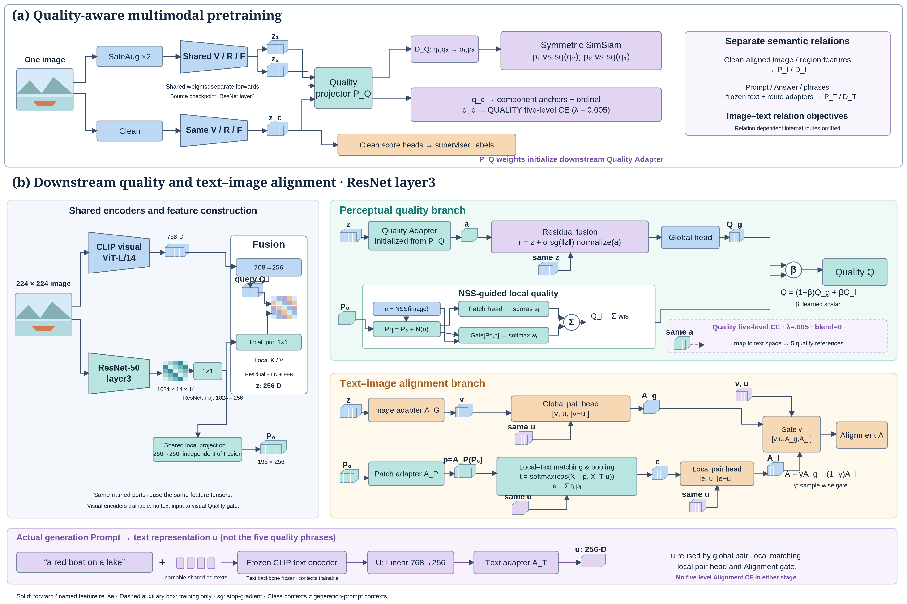

# Clarified framework: stage, five-level objectives and explicit text/patch paths

[PNG](clarified_framework.png) · [SVG](clarified_framework.svg)

This revision is an image only; no PowerPoint changes are requested or made.

## Confirmed experiment configuration

From the uploaded pretraining CSV `all_results_richhf18k_quality_classprompt_cliplarge_seed42.csv`: source checkpoint uses the default layer4, Quality text bank enabled, class_context_tokens=4, lambda_quality_text_ce=0.005, score_blend=0, no Alignment text bank.

From uploaded downstream layer3 experiment configurations: layer3 is explicitly enabled; the same Quality text bank is enabled with lambda_quality_text_ce=0.005 and blend=0. No Alignment text bank/Alignment five-level CE is enabled. The uploaded source checkpoint hash is 9a140f598c8bd09812f92e8355dce7148d4b649c89646094823f39f8bcc3bf34. Do not describe the source pretraining as layer3 without a newly supplied layer3-pretrained checkpoint.

## One pretraining image, two input routes

The figure should show one original input thumbnail. SafeAug×2 is an image-space branch before encoding: I→SafeAug→shared encoder→z1/z2→PQ. Clean image takes the clean encoding branch→zc→the same PQ and separate Clean scoring heads. A label immediately upstream of PQ may describe SafeAug provenance but must not imply augmenting latent features after the encoder. Three encoder calls use the same weights; inputs and feature tensors are distinct.

## Two supervision paths

- zc → PQ → qc → component anchors, ordinal constraints, Quality five-level CE. These losses directly constrain PQ.
- Clean shared global/local features → task scoring modules → labels. They update the shared visual backbone and their scoring heads, but do not directly traverse PQ.

## Explicit downstream text path

Prompt + shared learnable context → frozen CLIP text backbone (768-D) → U linear (768→256) → AT → u.

u is consumed by the global pair head alongside v=AG(z); by XT for local matching against XI(AP(P0)); by the local pair head alongside e; and by the Alignment gate alongside v,Ag,Al. The quality reference phrases use separate class contexts, although they call the same frozen text backbone. Real prompt text is not fed into the current visual Quality scoring gate.

The actual pretraining PT input routes differ: Prompt T+C→U→AT→XT→normalize→PT; Answer T+C→U→PT; auxiliary phrases T+C→U→AT→PT. The compact pretraining semantic group omits these internal adapters explicitly; it is not a claim of identical routes.

## Residual Quality Adapter

z→QA→a; r=z+alpha*stopgrad(norm(z))*normalize(a), then the global quality head scores r. alpha is learned with initialization0.1, not a percentage of final score contribution. Stop-gradient applies only to the norm estimate. Example z=(1,0), normalize(a)=(0,1), alpha=.1 gives r=(1,.1).

## Explicit patch adapter

P0→AP→p. AP is a distinct learnable residual adapter. normalize(XI(p)) and normalize(XT(u)) produce matching weights t; e=sum_i t_i*p_i pools AP outputs, not XI outputs. Local pair head consumes [e,u,abs(e-u)]. AG,AT,AP do not share weights. XI,XT do not share weights.

The intended visual style follows the user's paper-style preference. The generated overview is not an experimental attention visualization; weights/heatmaps are illustrative. The audited native technical reference and code remain authoritative for operator-level paths.

## Rendering

Image generation was used to explore the paper-style layout, but its draft connected the auxiliary CE to scoring and confused several feature routes. Those generated drafts are not published as the final architecture. The published figure is rendered from explicitly specified vector primitives and connections, with exactly one pretraining input image, an image-space SafeAug branch, an explicit AP, and no auxiliary CE→score connection. Reproduce with `python docs/figures/render_clarified_framework.py` (CairoSVG required). No PPT is created or modified.
