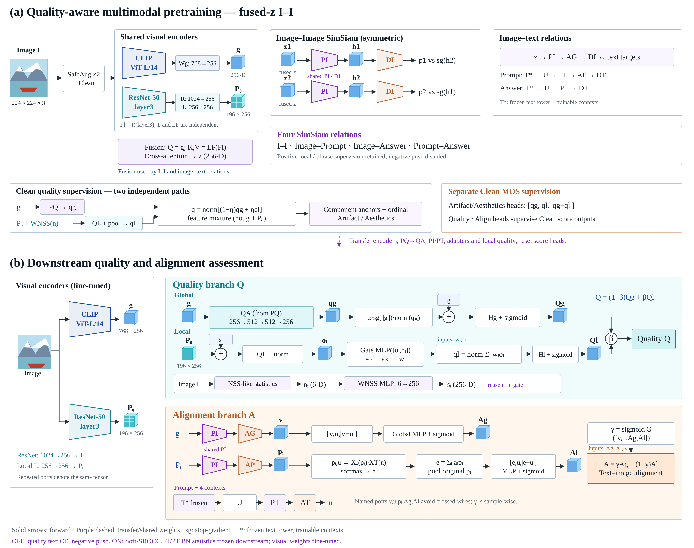

# 修订框图：融合 z 输入 I-I，质量路径分开，单个 NSS 提取器

[可编辑SVG](current_baseline_fused_z_clean.svg) · [矢量PDF](current_baseline_fused_z_clean.pdf)

本版根据用户四项反馈重新排版，手工定义矢量连接，避免生成式图片把g/P0误接。减少交叉长线，使用同名端口复用特征。生成源码：`scripts/draw_zii_framework.py`。图中文字省略部分归一化、激活、dropout，仅表达主路径，不把方框邻接解释成额外前向边。

## 1. I-I改用融合z

新增显式选项 `model.image_image_feature: z`：SafeAug两视图各自产生融合z，经共享PI，再经过DI，比较p1与sg(h2)、p2与sg(h1)，其中hi=PI(zi)。I-I直接回传到Fusion和ResNet局部编码器，不经过独立PQ。Image–Prompt/Answer也继续使用z→PI→AG→DI。

新预训练配置：`configs/zii_noce_noneg/pretrain_dev.yaml`，使用独立zii输出目录。旧配置默认行为仍是原来的g输入，不能把旧g实验成绩称为新z实验。要获得新z表示必须重新预训练；不能只改图后把旧权重当作已训练过z-I-I。

下游质量和一致性全局评分仍使用g，本次只改变预训练I-I输入，不把Quality改成融合z评分。

## 2. g从不直接和P0相加

全局：g→QA→qg；r=g+α·sg(norm(g))·normalize(qg)→global head→Qg。

局部：P0_i+si→QL→normalize→oi；wi=softmax(GateMLP([oi,ni]))；ql=normalize(Σwi·oi)→local head→Ql。这里先池化特征，再评分。

最终混合质量分数Q=(1−β)Qg+βQl。预训练另有q=normalize((1−η)qg+ηql)用于component anchors/ordinal；这也不是原始g+P0。Artifact/Aesthetics MOS头输入concat(qg,ql,abs(qg−ql))，Quality/Align MOS头监督各自Clean评分输出。

## 3. 单个NSS-like提取器，两个用途

从输入图像为每个局部位置提取ni∈R6（亮度/MSCN/梯度等轻量统计代理，不是6个网络，也不是完整的经典NSS参数拟合）。

- 用途一：ni→WNSS MLP→si∈R256，再与256维P0_i相加。
- 用途二：同一个ni直接与oi拼接，输入局部权重门控。不是再提取一次NSS。

代码中的WNSS实际为Linear(6,256)→GELU→Linear(256,256)，图中6→256表示其总体输入/输出维度。默认196个位置时：NSS描述为196×6，投影后为196×256。当前六维中的尺度代理复用二阶矩，因此六个通道并非六个独立统计量。

## 4. 结构与训练状态

两阶段layer3，CLIP ViT-L14 QuickGELU。PQ/QA与PI独立；同一PI复用于Align全局g与局部P0，PT在文本U之后、AT之前。Prompt和Answer共享PT，但Answer绕过AT。视觉编码器微调，文本编码器本体冻结、contexts可学习；下游PI/PT只冻结BN运行统计。

CE和负例push关闭，Soft-SROCC保留原系数。预训练component anchors/ordinal和PCGrad保留。1K仍是明确单独报告的subset1078；I-I改z不改变已经确定的子集成员和评估协议。旧实验和本新结构需分别标记。
