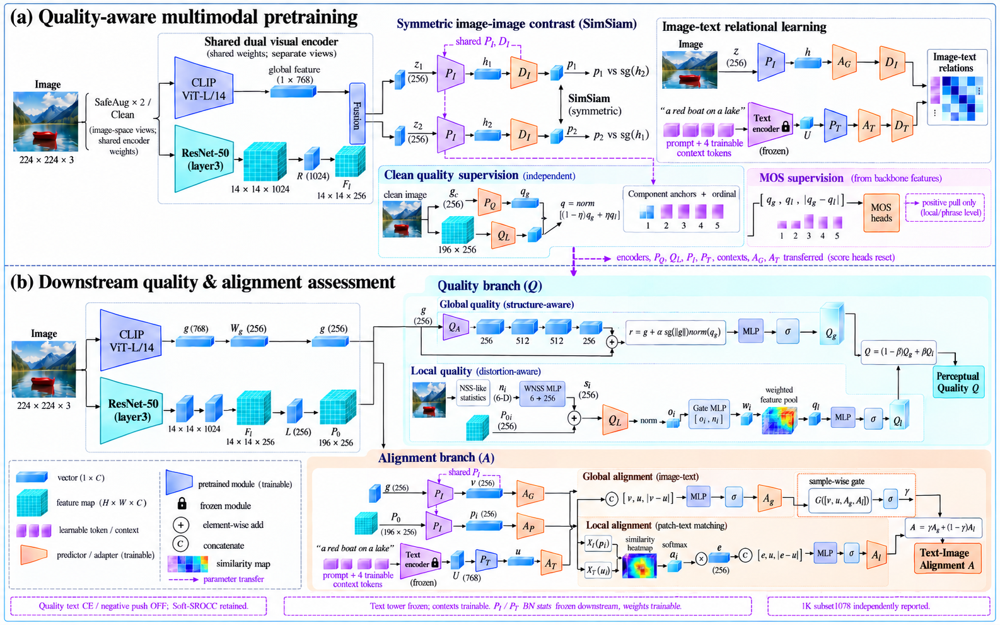

# 按用户第二张参考图生成的完整论文插图风格版

本图针对用户指定的第二张参考图视觉样式生成：真实图片缩略图、立体特征块、梯形模块、关系热图、上下两阶段布局、青色质量与橙色一致性分区。它与简化矢量稿是两个文件，本文件用于展示完整视觉排布。

方法为用户指定的 fused-z I-I 版本；该新版本需独立预训练，不改变历史g输入实验成绩。精确模块输入、维度、NSS提取/投影、PQ独立性及迁移约束参照 [修订路径说明](current_baseline_fused_z_clean.md)。生成图中的局部符号属于视觉示意，不能替代代码和精确路径表：WNSS为6维到256维的MLP而不是维度相加；Align的v是AG输出、u是AT输出；局部pool的值为AP输出pi。
