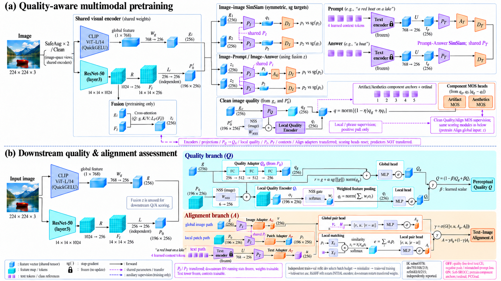

# 当前基线：参考论文插图风格版本

按照用户提供参考图的视觉风格重新生成：上下两阶段、Times风格衬线文字、梯形编码器、蓝色立体向量、青色网格特征、紫色文本token、橙色adapter/predictor，以及浅青/浅橙质量和一致性面板。

结构对应当前两阶段noce/negative-free、layer3、shared PI/PT、dual-quality residual基线；1K单独使用subset1078。预训练不合并的对照模型结构相同，仅训练协议不同。

图片属于结构示意，局部连线存在省略，精确代码路径沿用 [当前基线路径表](current_baseline_subset1078.md)。特别是：

- P0与图像NSS投影是独立输入，需相加后进入局部质量编码器；NSS不是由P0计算。
- XI、XT仅用于local matching权重，实际pool的是适配后pi。
- 预训练图片端PI后实际有AG，再进入DI；图中重复的PI/DI共用参数，各关系的SG目标为对应投影/适配表示，不是predictor输出。
- Clean混合q监督component anchors/ordinal；component MOS heads使用[qg,ql,abs(qg−ql)]，不是从混合q或component MOS头串联到其他MOS头。
- Prompt用U→PT→AT，Answer用U→PT，Answer不经过AT。下游PI分别接全局g和局部P0，然后分别进入AG/AP。

不把参考图中的旧layer4、质量五档CE、下游融合z直接评分及逐patch质量分数池化当成当前模型。最终score混合、Soft-SROCC和合并协议参照路径表与训练配置。
