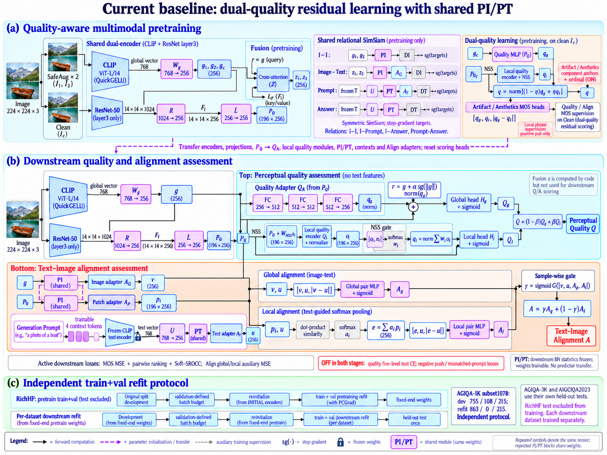

# 当前基线框图：dual-quality residual + shared PI/PT

对应配置：`configs/allmerged_noce_noneg/pretrain_dev.yaml`、`configs/agiqa1k_subset1078/allmerged.yaml`；预训练不合并的 `both` 对照使用相同模型结构，但只执行下游合并。框图为 imagegen 生成的结构示意；同名端口表示共享特征，模块共享和精确输入以下表为准，不把跨区长连线交点解释为额外特征融合。

## 精确路径

| 部分 | 实际代码路径 |
|---|---|
| 全局特征 | CLIP ViT-L/14 QuickGELU → 768 → Wg → g(256) |
| 局部特征 | ResNet-50 layer3(14×14×1024) → R(1024→256) → Fl → L(256→256) → P0(196×256) |
| 预训练融合 | g作query，独立的LF(Fl)作key/value → z；LF与L不是同一个投影 |
| I-I | SafeAug两视图的g → 共享PI → DI，双向stop-gradient SimSiam |
| Image–Prompt/Answer | 视图z → PI → AG → DI，与文本表示形成SimSiam关系 |
| 主Prompt预训练 | 冻结文本编码器+可学习contexts → U → PT → AT → DT |
| Answer预训练 | 文本编码器 → U → PT → DT，不经过AT |
| Clean质量全局 | gc → PQ → qg；PQ是持久化quality_adapter，和PI独立 |
| Clean质量局部 | P0+WNSS·NSS → QL并归一化 → NSS gate权重 → 特征加权池化并归一化 → ql |
| Component监督 | q=normalize((1−η)qg+ηql) → Artifact/Aesthetics component anchors + ordinal |
| Component MOS heads | 输入concat(qg,ql,abs(qg−ql))；不是只输入上行混合q |
| Quality MOS | 通过同下游的全局残差质量评分、局部质量评分和分数混合得到Q，再监督Q |
| Align MOS预训练 | 全局输入z，不是g；局部P0与Prompt输入和下游同类Align路径 |
| 下游Quality全局 | g → QA(PQ迁移) → qg；r=g+α·sg(norm(g))·normalize(qg) → Hg+sigmoid → Qg |
| 下游Quality局部 | P0+WNSS·NSS → QL归一化 → NSS gate加权池化 → ql → Hl+sigmoid → Ql。先池化特征，再评分 |
| Quality输出 | Q=(1−β)Qg+βQl；α、β是可学习标量 |
| 下游Align全局 | g → PI → AG → v；concat(v,u,abs(v−u)) → global pair MLP+sigmoid → Ag |
| 下游Align局部 | P0 → 同一PI → AP → pi；XI(pi)、XT(u)算点积softmax权重ai；e=Σai·pi；concat(e,u,abs(e−u)) → local pair MLP+sigmoid → Al |
| 下游Prompt | 冻结文本编码器+4可学习context tokens → U(768→256) → PT → AT → u |
| Align输出 | γ=sigmoid(G(concat(v,u,Ag,Al)))；A=γAg+(1−γ)Al |

图中的局部matching为简化示意，实际有XI/XT两个可学习投影。注意pool的是pi，不是XI(pi)。PI的两个图示实例是同一模块复用，不是串行调用。Quality不输入Prompt特征；预训练使用q做component监督，当前下游不再使用五档文本辅助分支。

图中Quality/Align Clean MOS说明框和component MOS框是不同监督路径；component MOS头没有输出到Quality/Align评分头的前向边。真正进入global pair的是v和u，局部pi不输入global pair。NSS来自图像，与P0进行融合，并非从P0生成NSS。

## 迁移与开关

编码器、现有投影、PQ/QA、local quality/NSS、PI/PT、contexts、Align adapters等按现有严格加载器迁移；评分头重置，SimSiam predictors不迁移。PI/PT在下游冻结BN运行统计，权重仍可训练。CLIP文本编码器本体冻结，contexts可训练。

两阶段质量五档文本CE关闭；局部/短语负例push和下游旧错配Prompt损失关闭。Component anchors/ordinal仍在预训练中开启；Soft-SROCC按各配置原系数保留。预训练PCGrad开启，当前下游未启用PCGrad。下游Quality和Align全局路径均使用g，z仍会被代码计算但不参与这两个评分分支。

## 合并协议

预训练先原划分开发确定batch预算，再从初始编码器重新合并RichHF train+val训练，使用固定结束点权重；RichHF test不参与。下游从这份权重开发定预算，然后重新初始化并合并各自train+val，最终单次测试。

1K使用独立subset1078：开发755/108/215，合并863/0/215；剩余样本保留原split归属，仅移除冲突图的两条记录。3K、2023分别训练/测试，不与1K拼接。固定预算不保证结束模型是全部中间轮次最好的。

代码参照：`models/two_stage_models.py` 中 `forward_single`、`_forward_three_views`、`_quality_from_patches`、`_align_from_global_and_patch`、`project_shared_image`、`project_align_text`；训练与开关见 `train_cm_pretrain.py`、`train_cm_iqa.py`。
