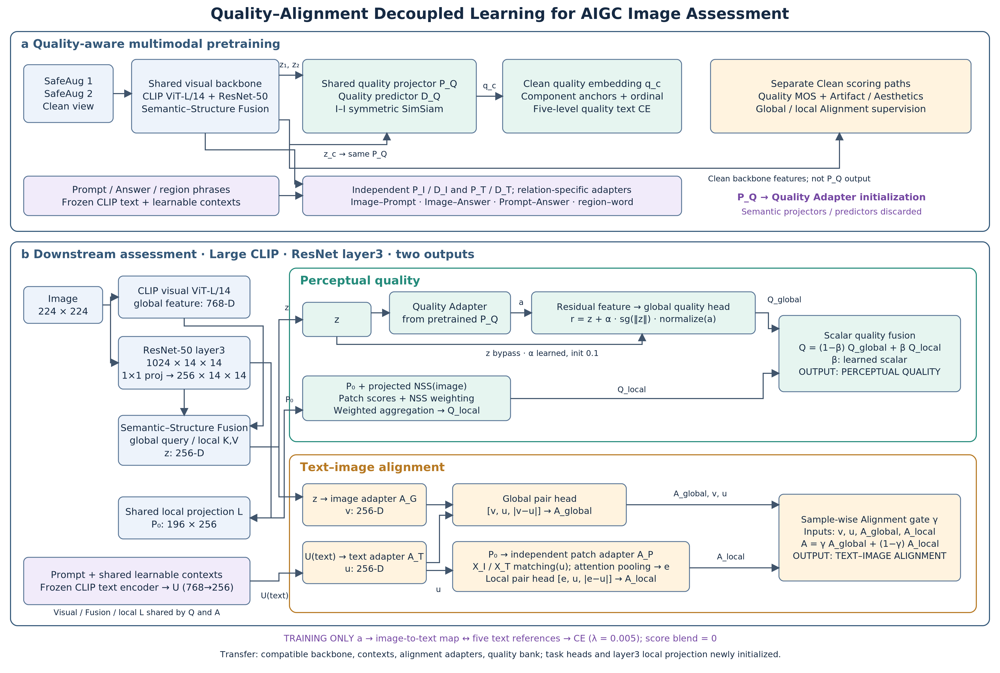

# Journal-style framework illustration

[PNG overview](journal_framework.png) · [Editable SVG](journal_framework.svg) · [Vector PDF](journal_framework.pdf) · [Downstream vector reference](journal_downstream_reference.svg) · [Pretraining vector reference](journal_pretrain_reference.svg)

Framework checked against implementation at `e127834`. The figure uses the retained uniform method: CLIP ViT-L/14, downstream ResNet-50 layer3, residual-feature Quality Adapter, scalar Quality fusion, independent global/local Alignment heads and sample-wise Alignment fusion. PCGrad is an optimizer option, not a forward module. Backbone LR reduction is an ongoing ablation. Quality sample-wise gating remains optional and is not included as the established main method.

## Figure scope

- Pretraining uses the existing checkpoint source. Do not infer layer3 pretraining from the downstream layer3 depiction: source local features are layer4; downstream explicitly initializes a new 1024→256 projection.
- Pretraining Quality projector is constrained by I–I SimSiam, Artifact/Aesthetics component anchors and ordinal losses, and five-level text CE. MOS/component regression heads are separate paths through shared visual features.
- PQ→Quality Adapter is weight initialization across stages, not simultaneous parameter sharing. Semantic projectors and SimSiam predictors are discarded downstream; task scoring heads and local/matching projections are reinitialized under representation transfer.
- The image is an overview. Exact relation-dependent Prompt/Answer/phrase adapter routes and all auxiliary loss coefficients remain in [the detailed specification](model_forward_and_sharing.md).
- Downstream text backbone is frozen; contexts remain trainable. Five-level quality phrases use independent class contexts but the same frozen transformer. Quality bank contributes auxiliary CE with blend=0.
- Quality and Alignment share the visual backbone, Fusion and local patch projection L. Quality adds projected NSS to local tokens; Alignment does not. Image/text/patch alignment adapters are independent.
- The established Quality beta is a learned scalar; Alignment gamma is sample-wise. There is no supervised Final score or Authenticity output.

Suggested caption: **Overview of quality–alignment decoupled learning.** (a) Quality-aware multimodal pretraining couples augmentation-consistent image representations with component-level quality constraints and image–text relation objectives. (b) The downstream model combines CLIP global semantics with layer3 local features, and predicts perceptual quality and text–image alignment through separate global/local branches. The pretrained quality projector initializes a residual Quality Adapter; the five-level text objective remains auxiliary. Solid arrows denote forward computation, whereas dashed transfer arrows denote parameter initialization. The downstream local projection and task scoring heads are newly initialized.

The image module was used for visual exploration. Its drafts contained incorrect connections and are not the published figure. The final overview is deterministically drawn from explicit geometry and connections, with SVG/PDF vector exports and 3800×2560 PNG. Repeated z/P₀/U symbols denote the same shared feature tensors; grouped local blocks summarize internal heads. Detailed SVG/DOT diagrams are supplied for full connectivity. Regenerate the overview using `python docs/figures/render_journal_overview.py` (requires CairoSVG); technical references require Graphviz.

## Editable technical references

- [Downstream SVG](journal_downstream_reference.svg) / [PNG](journal_downstream_reference.png)
- [Pretraining SVG](journal_pretrain_reference.svg) / [PNG](journal_pretrain_reference.png)
- Regenerate with `python docs/figures/render_journal_references.py` (Graphviz required).
