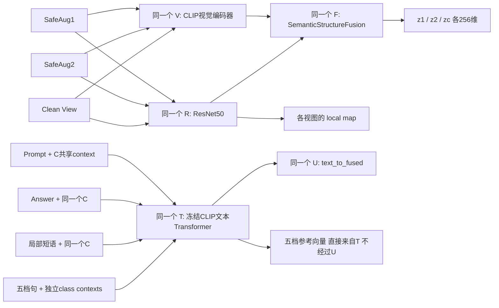
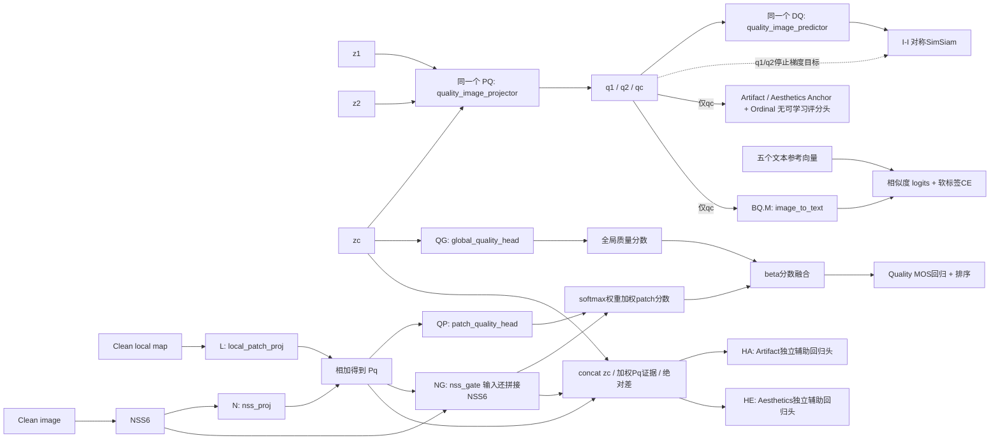
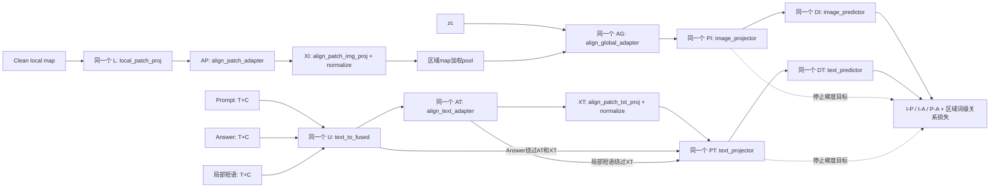
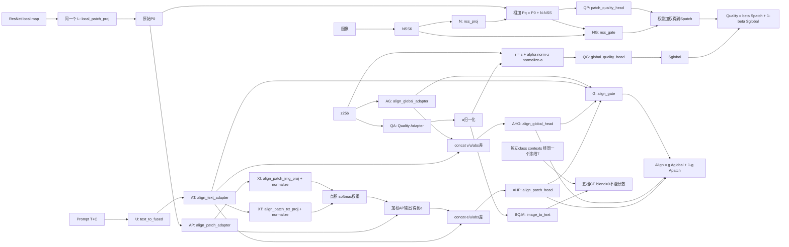

# 具体前向流程、预测头和参数共享

代码基线 `966306b`；主线是 Large、three_view、separate_quality_projection、Quality class contexts，预训练 Adapter 关闭；下游 residual_feature、blend=0、无额外 attention / crops / V-Mamba / Align bank。

- [预训练详细图 PNG](pretrain_heads_and_sharing.png) · [可缩放 SVG](pretrain_heads_and_sharing.svg)
- [下游详细图 PNG](downstream_heads_and_sharing.png) · [可缩放 SVG](downstream_heads_and_sharing.svg)

使用 image 模块制作草图后，发现其会误画串并联和共享关系；发布版采用 Graphviz 逐条指定连线，提供 PNG、SVG、DOT 和可重复生成脚本，不采用错误草图。下面的 Mermaid 与参数表逐条对应代码。图中的同一 ID 表示同阶段同模型实例里的同一参数对象；不同 ID 即使形状相同也不共享。

## 一、共享视觉与文本入口



图中最后两条边表示按文本用途分流：只有真实 Prompt / Answer / 局部短语进入 U，五档质量句不进入 U。五档 contexts 与 C 是不同参数，只共享 Transformer 的冻结权重。视觉三个视图分别前向，不是三个编码器；每次的输出张量不同。下游只输入一张图，复用同样的结构。

## 二、预训练：质量投影与评分是两条路径



q1/q2 进入 I-I，qc 进入 Anchor 和五档 CE。三者使用同一个 PQ，DQ 同样共享。qc 的 predictor 输出也会被计算，但当前 Clean View 的 Anchor / CE 使用 qc，不使用 predictor 输出。

重要：预训练 `quality_adapter.enabled=false`，因此 MOS 评分路径不经过 PQ。Artifact/Aesthetics 回归辅助头 HA/HE 同样不直接消费 PQ；Component Anchor / Ordinal 才直接约束 PQ。它们都能通过各自梯度更新共享视觉主干。

## 三、预训练：图文投影头与真正的共享关系



这里的 U/AT/PT 是多次调用同一模块，不是图中产生新的实例。分流边有明确文本用途，不代表一个输入同时走所有路。

- 主 Prompt 输入 PT 前，实际上是 `normalize(XT(AT(U(T(Prompt)))))`。
- Answer 输入 PT 前，是 `U(T(Answer))`，没有 AT / XT。
- 局部 aligned/misaligned 短语输入 PT 前，是 `AT(U(T(phrase)))`，没有 XT。
- 主 Prompt 被 PT/DT 独立调用两次，供全局与区域关系使用；参数相同，dropout 和 BN 前向行为可能不同。
- 区域输入不是原始 ResNet token，而是经过 L / AP / XI / normalize 的特征再加权 pool，随后使用同一个 AG / PI / DI。
- z1/z2 也前向经过 AG/PI/DI；当前 strict three-view 的 I-P/I-A 主损失使用 zc 对应的 clean 输出，不使用 SafeAug 的语义关系结果。前向计算不等于一定进入当前加权总损失。

这些上游差异是当前代码事实，不应在图中把 Prompt / Answer / phrases 画成完全相同的流水线。

## 四、下游：具体的评分头



L 在 Quality 与 Align 中分别调用，权重相同。Quality 使用加上 N(NSS) 的 Pq；Align 使用未加 NSS 的 P0。这不是两个 local_patch_proj。

残差模式只有一个 QG，没有 `quality_adapter_head`。QG 除了预测 r，还会以 eval 模式分别预测 z、a 作为诊断，仍是同一评分头的不同输入；a 的诊断分数不是另一个独立训练的质量分类器。

### 评分、投影、预测、门控层清单

| ID / 代码模块 | 当前结构或作用 | 参数关系 |
|---|---|---|
| PQ / quality_image_projector | MLP 256→512→512→256，BN/ReLU/dropout/末层BN，输出归一化 | 各图像视图共享；与 PI/PT 独立 |
| PI / image_projector | 同结构 MLP | 图像与区域共享；与 PQ/PT 独立 |
| PT / text_projector | 同结构 MLP | Prompt/Answer/phrases 共享；与 PQ/PI 独立 |
| DQ / quality_image_predictor | 256→128→256，BN/ReLU | 各质量视图共享；与 DI/DT 独立 |
| DI / image_predictor | 256→128→256，BN/ReLU | 各语义图像/区域共享 |
| DT / text_predictor | 256→128→256，BN/ReLU | 各文本关系共享 |
| QA / quality_adapter | 与 PQ 兼容的 MLP | PQ 权重初始化，不是跨阶段同一个参数对象 |
| QG / global_quality_head | 256→256→128→1，GELU/dropout，外部 sigmoid | 残差主评分与 z/a 诊断复用同一头 |
| QP / patch_quality_head | 256→256→1，外部 sigmoid | 与 QG 独立 |
| NG / nss_gate | 262→256→1，外部 softmax over patches | 输出权重，不是质量分数 |
| N / nss_proj | 6→256→256 | 只给 Quality patch tokens 加NSS |
| AHG / align_global_head | 768→256→128→1，外部 sigmoid | 与 AHP 同结构但独立 |
| AHP / align_patch_head | 768→256→128→1，外部 sigmoid | 与 AHG/QG 独立 |
| G / align_gate | 514→256→1，外部 sigmoid | 独立门控网络，不与NG共享 |
| XI / align_patch_img_proj | Linear 256→256 + normalize | 与XT独立 |
| XT / align_patch_txt_proj | Linear 256→256 + normalize | 下游局部attention与预训练主Prompt表征共用 |
| AG/AT/AP | 三个 ResidualAdapter，LayerNorm→Linear256→256→GELU→dropout→Linear256→256，残差scale=0.1 | 三个独立模块，不能画成一个共享Adapter |
| HA/HE / quality_aux_heads | 各自 768→256→128→1，外部sigmoid | 预训练两个独立回归头 |
| BQ.M / quality_text_bank.image_to_text | 无bias Linear 256→768 | 与 U/XI/XT 无共享 |
| BQ class_context | 5×4×768 的独立可学习输入context | 五组彼此独立，不与C绑定 |
| U / text_to_fused | Linear 768→256 | Prompt/Answer/phrases共享；五档参考句不走U |
| L / local_patch_proj | Conv1×1 256→256 | Quality与Align共享 |

Fusion 内部另有 `semantic_proj`（768→256）、`local_proj`（Conv1×1 256→256）、MultiheadAttention、FFN 和两个 LayerNorm。**Fusion.local_proj 与 L/local_patch_proj 是不同模块**，即使都是 1×1 Conv、输入输出维数相同也不共享；只有各视图复用同一个 Fusion。CLIP 视觉 Transformer 与文本 Transformer 也不共享参数。

表中 hidden 维数对应当前主线配置；不是所有可配置模型的固定常数。sigmoid/softmax/归一化/相似度本身无额外可学习参数。

### 被计算、被监督、被迁移是三件不同的事

- Component Anchor / Ordinal 使用固定几何锚点，无独立可学习回归头。
- s_final 仍作为 `sigmoid(fusion_logit)×Quality + (1−sigmoid(fusion_logit))×Align` 被计算；当前两输出协议不监督它。没有独立 Final 回归头，可选动态 fusion_gate 关闭。
- 当前关闭的模块：Quality text_gate、额外 Quality attention、Align token cross-attention、V-Mamba、distribution head、Align text bank、下游 Artifact/Aesthetics 辅助头。
- three-view 下 quality_clean_p 被计算，但 Anchor / CE 不消费它。score_clean 内会先算一次 Quality bank（输入是z，因为预训练Adapter关闭），之后同一 bank 在 qc 上重算并覆盖输出；当前五档监督使用后者。不要把两次前向画成两个 bank。

## 五、迁移不是实时参数共享

| 预训练来源 | 下游去向 | 当前representation scope |
|---|---|---|
| V/R/F | V/R/F | 复制初始化，后续微调 |
| C、U | C、U | 复制初始化，contexts可训练 |
| AG/AT/AP | AG/AT/AP | 复制初始化 |
| PQ | QA | 复制初始化，包括兼容BN状态 |
| BQ | BQ | 复制contexts、映射及相应buffers |
| PI/PT、DQ/DI/DT | 无对应SimSiam头 | 不迁移 |
| QG/QP/NG/N/L、XI/XT、AHG/AHP/G | 对应下游同名模块仍存在 | 当前scope不加载，重新初始化 |
| HA/HE | 当前下游未启用 | 不迁移 |
| T基础Transformer | T | 冻结CLIP来源初始化，representation不从该checkpoint恢复全部基础文本权重 |

即使预训练和下游都叫 QG，也不代表当前 scope 继承其权重；同名与迁移是两个概念。PQ→QA 同样不意味着两个阶段同时运行并共享存储。

## 代码依据

[模型与前向](../../models/two_stage_models.py#L1375)、[Quality局部路径](../../models/two_stage_models.py#L986)、[Align路径](../../models/two_stage_models.py#L1172)、[迁移加载](../../models/two_stage_models.py#L1668)、[预训练损失](../../train_cm_pretrain.py#L1950)。本说明不改变任何训练行为，也不证明各头均有独立消融收益。

## 核对与再生成

用现有 TinyBackbone 小模型对 `_forward_three_views` 注册 forward hooks，验证基础前向次数：L=2、PQ=3、DQ=3、PI=3、DI=3、PT=3、DT=3；PQ/PI/PT 为不同对象。这不包括训练循环随后执行的区域/词级损失额外前向，也不是 GPU 性能测试。

再生成精确 PNG / SVG / DOT（需安装 Graphviz）：

```bash
XDG_CACHE_HOME=/workspace/.cache python docs/figures/render_model_flows.py
```

SVG 可无限放大，建议查看 SVG 或下载原尺寸 PNG；图内按 A/B/C/D/E 面板分块，不跨面板画拥挤长连线，跨面板输入通过同名特征、模块 ID 对应。
