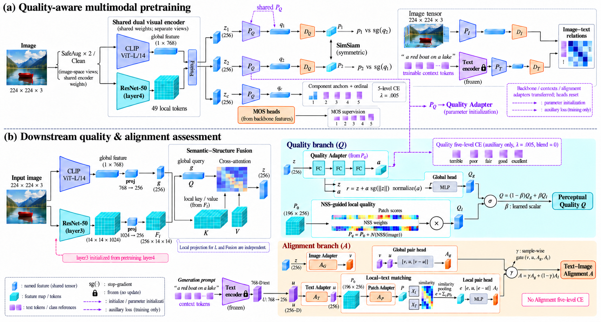

# Reference-style paper illustration

Recreated with the image module in the user's supplied paper-figure style: serif panel headings, blue 3D feature vectors, teal local voxel grids, purple text elements, attention heatmaps, and cyan/peach task panels. This is a raster scientific overview, not an editable vector diagram or a new PPT.

The pretraining image-space views are summarized next to one original input photo. Retained method: source pretraining layer4, downstream layer3, quality-only five-level CE in both stages, scalar Quality fusion and sample-conditioned Alignment fusion. AP is shown explicitly. The relation-dependent text adapters and some internal operators are grouped.

This visual overview does not replace the operator-level audit in [the precise specification](model_forward_and_sharing.md) or [the connection audit](../presentations/framework_line_audit.md). Some generated small labels and port lines remain ambiguous: Clean embedding must be qc; Clean MOS heads consume backbone features rather than PQ output; PQ weights, not the component-loss block, initialize QA; residual inputs are independent named z and a features; local matching consumes p=AP(P0) and u. Read these routes according to the audited specification, not inferred from an incidental line crossing. No training code or experimental result is changed.
