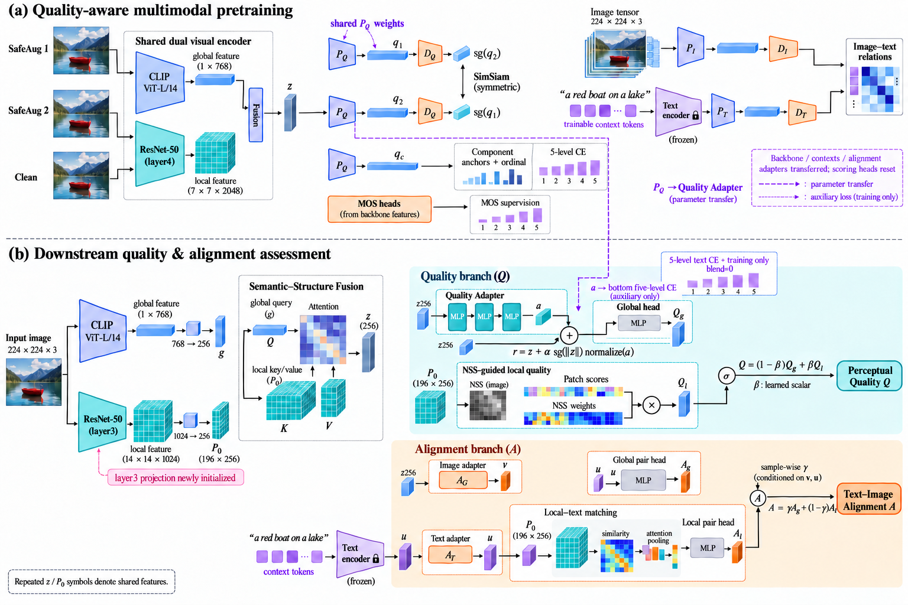

# Paper-style framework figure

This is the revised paper presentation, separate from the earlier box-oriented technical reference. The image module supplies the tensor stacks, patch grids, attention illustrations and two-panel composition. This is a raster overview, not an editable vector graphic. The precise module inventory and branch-dependent text routes are documented in [the technical specification](model_forward_and_sharing.md).

The retained uniform model uses scalar Quality fusion. The optional sample-wise Quality gate and reduced backbone learning rate are experimental and not asserted to be adopted components. The Alignment gate remains sample-conditioned. The source checkpoint uses layer4; downstream uses layer3 with explicit local projection reinitialization. CLIP visual encoders are trainable; text backbone is frozen, contexts trainable.

## Caption

Figure. Quality-aware multimodal pretraining and downstream dual-output assessment. The shared visual backbone fuses global CLIP features with local ResNet features. Quality-aware pretraining constrains the quality projection space through augmentation consistency, component anchors, ordinal supervision and a five-level text objective; image–text objectives train a separate semantic space. In downstream assessment, the pretrained quality projector initializes a residual Quality Adapter. Global quality and NSS-guided local scores are fused with a learned scalar, while global and local image–text consistency scores use a sample-conditioned gate. The two outputs share visual features but use distinct scoring heads. Five-level text supervision remains auxiliary and does not directly mix into the quality score. The pretraining checkpoint uses layer4; downstream extraction uses layer3 with a newly initialized local projection.

## Status

This is a paper-style visual design draft, not a submission-ready exact wiring diagram. Image generation still omits or ambiguously renders several edges (global Quality output into fusion, image/text inputs into the global Alignment pair head, and local NSS/text input paths). These omissions must be corrected in a manually editable publication source before submission. The exact model specification linked above is authoritative. The figure is published separately from the exact technical reference so visual review does not silently replace code-level documentation.
